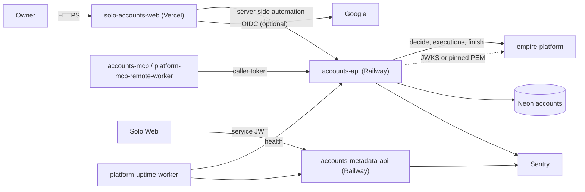
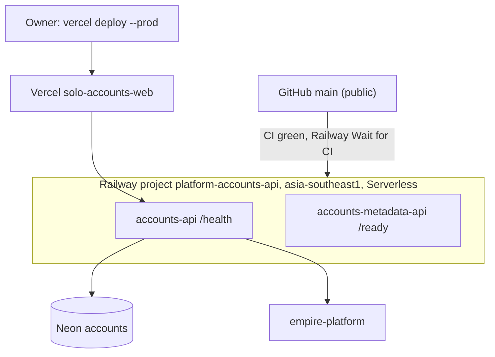

# Solo Accounts — System Architecture

สรุป architecture ของ Accounts cell (`platform-accounts-api`) จากโค้ดบน `origin/main` `0b1378a` (2026-11-04; โค้ดล่าสุดคือ `e7de6ce`, 2026-10-24) ร่วมกับชุดภาพ Core 22 ใน [`docs/diagrams/`](../docs/diagrams/README.md) รายละเอียดอยู่ในไฟล์ที่ลิงก์ ไม่ copy ซ้ำ

## 1. Architecture style และเหตุผล

- **Domain cell แบบ spec-driven**: resource, field, permission และ route ของ API ประกาศใน `cell.yaml` แล้ว `cellkit` (โค้ดที่ repo นี้เป็นเจ้าของเอง) สร้าง FastAPI CRUD ให้; rule เฉพาะ domain อยู่ใน `src/solo_accounts/routes.py` ([ADR-0001](../docs/diagrams/08-adr/ADR-0001-cell-from-spec-with-own-cellkit.md))
  - เหตุผล: cell หลายตัวใน Solo Empire ใช้ pattern เดียวกัน; owner ตัดสิน 2026-10-21 ให้แต่ละ repo ถือโค้ดของตัวเอง (`docs/cellkit-notes.md`)
- **Database-per-cell + forced RLS** ต่อ workspace ([ADR-0002](../docs/diagrams/08-adr/ADR-0002-own-neon-db-with-forced-rls.md))
- **Externalised authorization**: PDP, execution record และ audit อยู่ที่ empire-platform; cell เป็น policy enforcement point ([ADR-0003](../docs/diagrams/08-adr/ADR-0003-authz-and-audit-in-empire-platform.md))
- **Privacy by design**: API/DB เห็นเฉพาะ ciphertext ของ email; web เข้ารหัสฝั่ง server ([ADR-0004](../docs/diagrams/08-adr/ADR-0004-ciphertext-only-email-addresses.md))
- **BFF แบบ owner-only**: Next.js บน Vercel เรียก API ฝั่ง server ด้วย automation token ([ADR-0006](../docs/diagrams/08-adr/ADR-0006-owner-only-web-on-vercel.md))
- **Read-only projection service แยก** สำหรับ matrix ใน git ([ADR-0007](../docs/diagrams/08-adr/ADR-0007-git-matrix-read-only-metadata-service.md))

## 2. Quality-attribute scenarios

| Attribute | Scenario (stimulus → response) | Measure | หลักฐาน / guard |
|---|---|---|---|
| Security: isolation | token ของ workspace อื่นขออ่าน identity → ไม่เห็นแถว | 0 แถว | `contract.py::test_workspace_isolation`, `tests/test_identities.py::test_another_workspace_cannot_read_an_identity` |
| Security: authorization | PDP ตอบ deny หรือไม่พร้อม → 403 / 503 `authorization_unavailable` | fail closed | `contract.py::test_authorization`, ADR-0003 |
| Privacy | client ส่ง address แบบ plaintext หรือ risk report พยายามคืน ciphertext → ปฏิเสธ / ไม่คืน | ciphertext only | `tests/test_mailboxes.py`, `tests/test_risk_report_route.py` |
| Privacy: telemetry | เกิด error → Sentry ไม่ได้รับ body, header, URL, locals | scrub tests ผ่าน | `tests/test_sentry.py`, `services/accounts-metadata-api/tests/test_sentry.py` |
| Integrity: concurrency | PATCH ด้วย `expected_version` เก่า → 409 `conflict` | no lost update | `src/cellkit/app.py`, contract suite |
| Integrity: retries | create ซ้ำด้วย idempotency key เดิม → ได้ record เดิม | ไม่มีแถวซ้ำ | `contract.py::test_idempotent_create` |
| Integrity: input | integer เกิน column หรือ NaN/Infinity → 422 | refused | commit `78fa510` และ test `0ce3047` |
| Performance bound | workspace ใหญ่เกิน `MAX_ROWS` 20,000 ต่อ resource → 413 แทน scan ไม่จำกัด; findings ตัดที่ 1,000 | bounded | `src/solo_accounts/routes.py`; **ไม่มี test** (gap ใน 17) |
| Availability | Railway Serverless sleep → cold start ครั้งแรก | ไม่ได้วัด | `.railway/railway.ts` `sleepApplication: true` |

## 3. Context diagram

ภาพเต็ม: [05-c4-context.md](../docs/diagrams/05-c4-context.md)

## 4. Components / containers

ภาพ container: [06-c4-container.md](../docs/diagrams/06-c4-container.md); component ของ accounts-api: [07-c4-component.md](../docs/diagrams/07-c4-component.md)

| Container | Runtime | หน้าที่ | หลักฐาน |
|---|---|---|---|
| `accounts-api` | Python FastAPI (cellkit), `python:3.13-slim`, port 3623 | `/v1/identities`, `domains`, `mailboxes`, `accounts`, `risk-report` | `cell.yaml`, `Dockerfile`, `src/cellkit/`, `src/solo_accounts/routes.py` |
| `accounts-metadata-api` | Python stdlib HTTP, `python:3.12-slim`, port 3470 | read-only projection ของ `ACCOUNT-MATRIX.yaml` | `services/accounts-metadata-api/` |
| `solo-accounts-web` | Next.js 16.4.2, React 19.3 บน Vercel | owner sign-in (password scrypt + TOTP หรือ OIDC), CRUD forms, เข้ารหัส address | `web/` |
| `accounts-mcp` | Python stdio MCP | tools `accounts.<resource>.list/get/create/update/delete` | `src/cellkit/mcp.py`, `.mcp.json` |
| `accounts-db` / `accounts-publish` | Python CLIs | provision Neon, migrate, sweep outbox (`accounts-publish` ไม่มี cron) | `pyproject.toml` `[project.scripts]` |

## 5. Tech stack

| ชั้น | เทคโนโลยี |
|---|---|
| API | Python 3.13 (image) / 3.12 (CI), FastAPI, uvicorn[standard], psycopg 3, PyJWT[crypto], httpx, PyYAML, sentry-sdk |
| Metadata | Python stdlib `http.server`, PyYAML, vendored `service_auth` |
| Web | Next.js 16.4.2, React 19.3.0, TypeScript, Vitest |
| Database | PostgreSQL บน Neon; `pgserver` ใน test |
| Tooling | uv, Ruff, mypy (strict), pytest + coverage, Renovate |
| CI | `platform-ci-workflows` v1.1.1 (`ci-python.yml` ×2, `ci-node.yml`, `security.yml`) |

## 6. Data stores

| Store | ข้อมูล | หลักฐาน |
|---|---|---|
| Neon project `platform-accounts-api`, DB `accounts` (aws-ap-southeast-1) | schema `accounts`: identities, domains, mailboxes (ciphertext + hash), platform accounts, outbox; forced RLS ต่อ workspace | `migrations/0001_accounts.sql`, `0002`, [09-erd.md](../docs/diagrams/09-erd.md) |
| DB roles | `accounts_api`, `accounts_migrator`, `accounts_publisher` | `db/roles.sql` |
| `accounts/ACCOUNT-MATRIX.yaml` (git) | canonical matrix สำหรับ metadata-api | ADR-0007 |
| สิ่งที่ไม่เก็บ | password, recovery code, TOTP seed, token → ใช้ `vault_ref` | ADR-0004 |

Backup: repo ไม่มี backup job; **[ต้องยืนยัน]** ว่า DB `accounts` อยู่ใน `BACKUP_TARGETS` ของ ops-backups ([14-backup-dr.md](../docs/diagrams/14-backup-dr.md)); `ACCOUNTS_WEB_FIELD_KEY` หายเท่ากับอ่าน address ไม่ได้

## 7. Integrations

| ระบบ | ทิศทาง | ใช้ทำอะไร | หลักฐาน |
|---|---|---|---|
| Identity / JWKS | accounts-api verify RS256 ของ empire-platform ผ่าน JWK Set, fallback เป็น pinned PEM; audience `accounts-api` | bind workspace สำหรับ RLS | `src/cellkit/auth.py`, commit `4a96bcd`, `contract.py::test_jwks_*` |
| empire-platform PDP | `POST /v1/authz/decide`, `/v1/executions`, `/finish` | authz + audit รวมศูนย์ | `src/cellkit/platform.py` |
| Google OIDC | web → IdP (optional) | sign-in | `web/lib/auth.ts`; client ยังไม่ตั้ง (open) |
| Sentry | ออก (เมื่อตั้ง `SENTRY_DSN`) | errors only, scrubbed | `src/cellkit/_sentry.py`, `services/accounts-metadata-api/_sentry.py` |
| Neon | SQL ผ่าน TLS; Neon API ใน `accounts-db provision` | primary store | `src/cellkit/db.py` |
| platform-uptime-worker | เข้า: health probe ทั้งสอง service | monitoring | [20-observability.md](../docs/diagrams/20-observability.md) |
| API gateway | ไม่พบ config ใน repo | — | open question |
| R2 / Queues / Kafka | ไม่มี; outbox มีแต่ไม่มี consumer ที่ deploy | — | not_applicable |

## 8. Deployment topology

ภาพเต็ม: [16-deployment.md](../docs/diagrams/16-deployment.md); pipeline: [15-cicd-pipeline.md](../docs/diagrams/15-cicd-pipeline.md)

- web deploy เป็น manual ตาม README; ยังไม่ยืนยันว่า Vercel ผูก Git หรือไม่
- env ใช้ชื่อเท่านั้น (ดูตารางใน 16-deployment.md)

## 9. ADR สำคัญ

| ID | การตัดสินใจ | ไฟล์ |
|---|---|---|
| ADR-0001 | Cell จาก `cell.yaml`, repo เป็นเจ้าของ `cellkit` | [ADR-0001](../docs/diagrams/08-adr/ADR-0001-cell-from-spec-with-own-cellkit.md) |
| ADR-0002 | Neon DB ของตัวเอง + forced RLS + role separation | [ADR-0002](../docs/diagrams/08-adr/ADR-0002-own-neon-db-with-forced-rls.md) |
| ADR-0003 | Authz / executions / audit ที่ empire-platform | [ADR-0003](../docs/diagrams/08-adr/ADR-0003-authz-and-audit-in-empire-platform.md) |
| ADR-0004 | API/DB เห็นเฉพาะ ciphertext; ไม่เก็บ secret | [ADR-0004](../docs/diagrams/08-adr/ADR-0004-ciphertext-only-email-addresses.md) |
| ADR-0005 | Railway Serverless Singapore, CD จาก `main` หลัง CI | [ADR-0005](../docs/diagrams/08-adr/ADR-0005-railway-serverless-cd-from-main.md) |
| ADR-0006 | Web owner-only บน Vercel ด้วย automation token ฝั่ง server | [ADR-0006](../docs/diagrams/08-adr/ADR-0006-owner-only-web-on-vercel.md) |
| ADR-0007 | Matrix ใน git เป็น canonical, serve ผ่าน metadata service read-only | [ADR-0007](../docs/diagrams/08-adr/ADR-0007-git-matrix-read-only-metadata-service.md) |

Central: architecture-docs ADR-0004 (TDD + SDD), ADR-0002 (production baseline)

## 10. Fitness functions

| Guard | สิ่งที่ปกป้อง | ที่รัน |
|---|---|---|
| Contract suite `src/cellkit/contract.py` (authorization, workspace isolation, idempotency, executions bound to record, JWKS) | ADR-0002, ADR-0003 | CI job `accounts-api` (pytest + pgserver + fake platform) |
| Domain rule tests (`test_identities.py`, `test_mailboxes.py`, `test_platform_accounts.py`, `test_risk_report*.py`) | rules + ciphertext-only (ADR-0004) | CI |
| Sentry scrub tests ทั้งสอง service | privacy ของ telemetry | CI |
| Metadata API tests (auth, readiness, projection) | ADR-0007 | CI job `accounts-metadata-api` |
| Web Vitest (`crypto`, `auth`, `password`) + `next build` + typecheck | ADR-0004, ADR-0006 | CI job `web` (`ci-node.yml`) |
| Coverage gates: accounts-api 58 %, metadata 78 % | test depth ratchet | CI |
| Ruff + strict mypy | code hygiene | CI |
| gitleaks, semgrep, osv-scanner, trivy-fs | secrets, SAST, dependencies | CI `security.yml` |
| Railway healthcheck + Wait for CI | ADR-0005 | Railway |

Gaps: ไม่มี e2e/browser test, ไม่มี test ของ MCP tools, risk report 413, web lockout/CSP ([17-test-coverage-matrix.md](../docs/diagrams/17-test-coverage-matrix.md)); web lint ถูก skip; `main` ไม่มี branch protection ([18-git-release-workflow.md](../docs/diagrams/18-git-release-workflow.md))

## 11. เอกสารลงรายละเอียด (SDLC phase 07)

tier ของ pack นี้คือ L0 จึงยังไม่บังคับ; ตารางนี้ชี้สิ่งที่มีอยู่แล้ว

| Template (architecture-docs) | สถานะ | ไฟล์ / เหตุผล |
|---|---|---|
| `sdlc/infrastructure-and-network-design.md` | partial (ภาพ) | [16-deployment.md](../docs/diagrams/16-deployment.md), [19-service-dependency-map.md](../docs/diagrams/19-service-dependency-map.md) |
| `sdlc/observability-design.md` | partial (ภาพ) | [20-observability.md](../docs/diagrams/20-observability.md); ไม่มี SLO |
| `sdlc/capacity-performance-and-cost-plan.md` | not_applicable ที่ L0 | มีแค่ `MAX_ROWS` / `MAX_FINDINGS` bound ในโค้ด |
| `sdlc/failure-mode-analysis.md` | partial (ภาพ) | [13-threat-model.md](../docs/diagrams/13-threat-model.md), [14-backup-dr.md](../docs/diagrams/14-backup-dr.md), [21-incident-response.md](../docs/diagrams/21-incident-response.md) |
| `sdlc/async-integration-contract.md` | not_applicable | outbox มีใน schema แต่ไม่มี publisher cron หรือ consumer ที่ deploy |
| `sdlc/frontend-architecture.md` | partial (ภาพ) | [03-user-flows.md](../docs/diagrams/03-user-flows.md), [13-threat-model.md](../docs/diagrams/13-threat-model.md) (CSP, session); ยังไม่มีสำเนา template |
| `sdlc/tech-debt-register.md` | not created | ที่พบ: `service.yaml` ล้าสมัย, web lint skip, ไม่มี branch protection, ไม่มี MCP tests |
| `operations/system-landscape.md` | central | **[ต้องยืนยัน]** row ใน architecture-docs |
| `development-cycle/vendor-dependency-review.md` | not created | vendor: Neon, Railway, Vercel, Sentry |

## 12. Open questions

- DB `accounts` อยู่ใน nightly backup หรือไม่; Neon retention; RTO/RPO
- สำเนา `ACCOUNTS_WEB_FIELD_KEY` ใน vault และขั้นตอน rotate key
- `SENTRY_DSN` ตั้งบนทั้งสอง Railway service แล้วหรือยัง
- Solo Web ยังเรียก `accounts-metadata-api` อยู่หรือไม่; จะรวม matrix เข้า accounts-api เมื่อไร
- Google OIDC client ของ web ยังไม่ตั้ง
- cell นี้อยู่หลัง `gateway.bookchaowalit.com` หรือไม่ (ไม่มี config ใน repo)
- Branch protection บน `main`; SPEC-001 "changes requested" (`e7de6ce`) ใครปิด

## การอนุมัติ

| บทบาท | สถานะ | วันที่ | ลงนาม |
|---|---|---|---|
| Solution Architect (Book Dev) | รอตรวจ | — | [ต้องยืนยัน] |
| Product owner | รอพิจารณา | — | ________ |

## แหล่งข้อมูล

อ่านที่ `origin/main` `0b1378a` (2026-11-04):

- `README.md`, `PRODUCT.md`, `AGENTS.md`, `cell.yaml`, `pyproject.toml`, `Dockerfile`, `.railway/railway.ts`
- `src/cellkit/app.py`, `src/cellkit/auth.py`, `src/cellkit/platform.py`, `src/solo_accounts/routes.py`
- `services/accounts-metadata-api/{server.py,Dockerfile,service.yaml,railway.toml}`
- `web/package.json`, `migrations/`, `db/roles.sql`
- `docs/cellkit-notes.md`, `docs/diagrams/*` (Core 22 pack ที่ `e7de6ce`), `docs/diagrams/08-adr/*`
- `git log` commits `4a96bcd`, `78fa510`, `b28bb84`, `a480f34`, `c226a9e`
