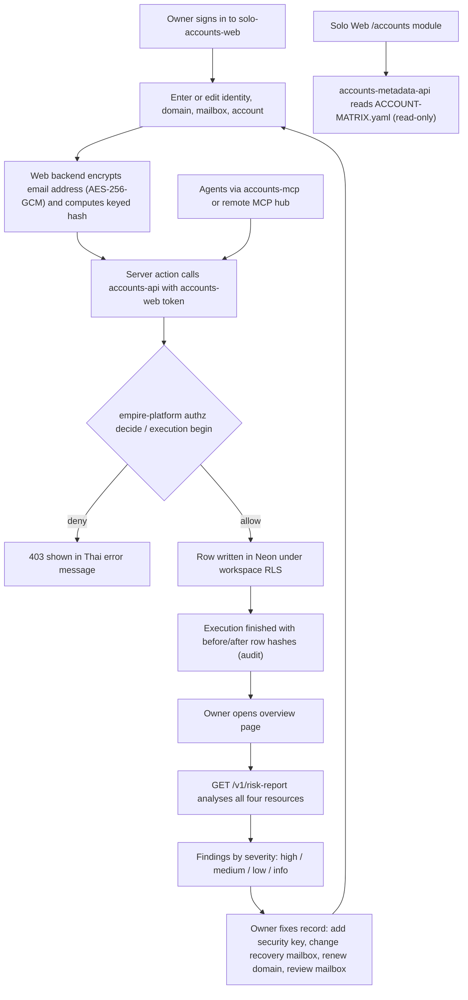
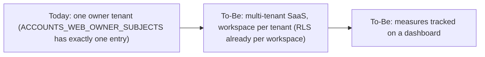

# 01 — Business process (As-Is / To-Be)

ระบบนี้คือ **Accounts cell**: inventory ของ identity, mailbox, platform account และ domain ของ owner พร้อม trust zone, recovery chain และ MFA posture เพื่อให้เห็นความเสี่ยง (เสีย mailbox เดียวแล้วเสียหลายบัญชี, domain หมดอายุ, brand ที่แยกไว้ถูกโยงกลับมาหา owner) ก่อนเกิดเหตุจริง ผ่าน `GET /v1/risk-report` ระบบ **ไม่เก็บ secret** (password, recovery code, TOTP seed) และ **ไม่เห็น email แบบ plaintext** เลย

## As-Is (จาก code วันนี้)

Sources: `README.md`, `PRODUCT.md`, `cell.yaml`, `src/solo_accounts/routes.py`, `src/cellkit/app.py`, `web/app/actions.ts`, `web/app/page.tsx`, `web/lib/crypto.ts`, `services/accounts-metadata-api/server.py`, `accounts/ACCOUNT-MATRIX.yaml`

### ขั้นตอนหลัก
1. **บันทึก inventory**: owner กรอกผ่าน web (หรือ import JSON ด้วย `web/scripts/import.ts` ที่เข้ารหัส address ระหว่างทาง, re-run ได้เพราะ match ด้วย natural key)
2. **ควบคุมสิทธิ์และ audit**: ทุก write ผ่าน empire-platform (`/v1/authz/decide`, `/v1/executions`, `/finish`)
3. **ประเมินความเสี่ยง**: risk report 13 finding codes (ดู `README.md`) เป้าหมายใน `PRODUCT.md` คือ "ไม่มี `high` finding ที่ไม่มีคำอธิบาย"
4. **ระบบเดิม (matrix)**: `accounts/` folder + `ACCOUNT-MATRIX.yaml` ยังถูก serve read-only ผ่าน `accounts-metadata-api`

## To-Be

จาก `PRODUCT.md` (ไม่มี `docs/UPGRADE-PLAN.md` หรือ spec ที่เป็น feature ใหม่; `specs/001-l2-baseline` เป็น tooling/test baseline):
- "built to become a multi-tenant SaaS" — OIDC ผ่าน IdP อื่น เช่น Clerk สำหรับ multi-tenant (`README.md` §Web)
- Measures ที่ต้องมี dashboard: high findings over time, `review_overdue`, weak MFA, 5xx/p95 (`PRODUCT.md` ระบุ "[ต้องยืนยัน: no dashboard records these yet]")

Sources: `PRODUCT.md`, `README.md`, `web/lib/auth.ts`, `migrations/0001_accounts.sql`

## Open questions
- Solo Web (`life-dashboard-web`) ยังเรียก `accounts-metadata-api` อยู่หรือไม่ หลัง `accounts-api` มาแทน matrix (`PRODUCT.md` [ต้องยืนยัน])
- แผน multi-tenant: timeline และ IdP ที่เลือก ไม่มีใน repo
- Google OIDC client id/secret ของ web ยังไม่ตั้ง (`PRODUCT.md` [ต้องยืนยัน])
