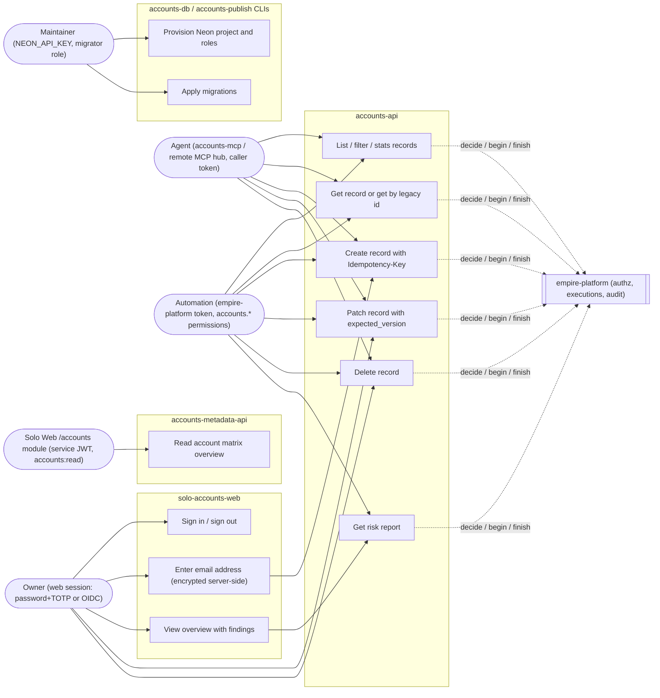

# 02 — Use cases

Actors มาจาก auth จริงใน code: owner ผ่าน web session (`web/lib/auth.ts`), agent ผ่าน MCP ด้วย token ของผู้เรียก (`src/cellkit/mcp.py`), automation ที่ถือ empire-platform token (permission `accounts.<resource>:read|write|delete`), Solo Web ผ่าน service JWT scope `accounts:read` (`services/accounts-metadata-api/server.py`), และ maintainer ที่ provision/migrate DB (`src/cellkit/server.py`)

| Use case | Permission / guard | Source |
|---|---|---|
| List/stats/get | `accounts.<resource>:read` via `/v1/authz/decide` | `src/cellkit/app.py` |
| Create/patch/delete | precheck + execution `accounts.<resource>:write|delete` | `src/cellkit/app.py` `write()` |
| Risk report | read on all four resources (`ctx.allow` loop) | `src/solo_accounts/routes.py` |
| MCP tools `accounts.<resource>.list|get|create|update|delete` | caller token; `EMPIRE_MCP_READONLY=1` = list/get only | `AGENTS.md`, `src/cellkit/mcp.py` |
| Matrix read | RS256 service JWT, audience `accounts-api`, scope `accounts:read` | `services/accounts-metadata-api/server.py` (`AuthPolicy.from_env`) |
| Web sign-in | one allow-listed subject → one tenant | `web/lib/auth.ts`, `web/lib/auth-routes.ts` |

Sources: `src/cellkit/app.py`, `src/cellkit/mcp.py`, `src/solo_accounts/routes.py`, `web/lib/auth.ts`, `web/lib/auth-routes.ts`, `services/accounts-metadata-api/server.py`, `src/cellkit/server.py`, `AGENTS.md`, `PRODUCT.md`

## Open questions
- `accounts-publish` (outbox → graph) มีอยู่ใน kit แต่ `cell.yaml` ไม่มี resource ใดประกาศ `graph` จึงไม่มี event ให้ส่ง (`docs/cellkit-notes.md`) — ยังต้องคงไว้หรือไม่
