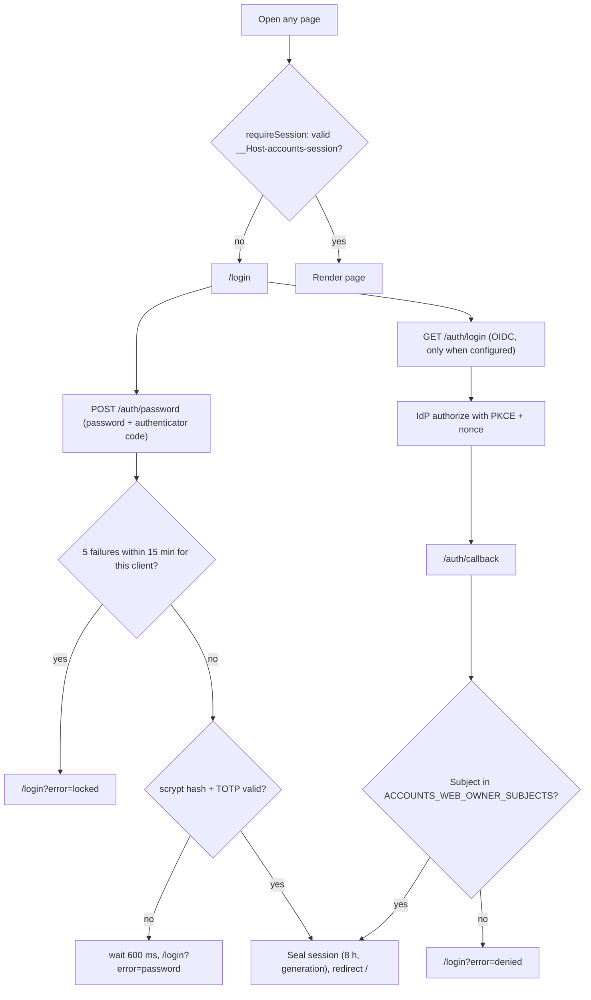
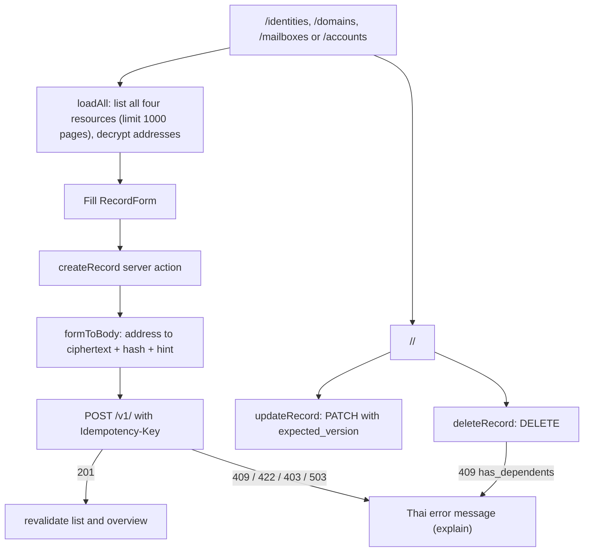
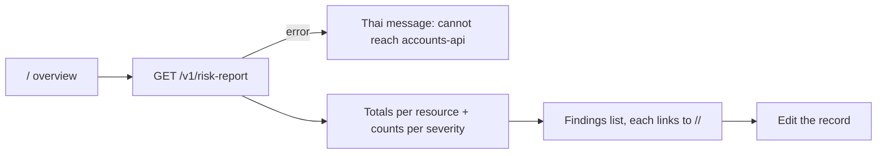

# 03 — User flows

Pages ใน `web/app/`: `/login`, `/` (overview + risk report), `/[resource]` (list + create form), `/[resource]/[id]` (edit/delete) และ route handlers `/auth/login`, `/auth/callback`, `/auth/password`, `/auth/logout` ข้อความ UI เป็นภาษาไทย

## Owner: sign in (password + TOTP หรือ OIDC)

## Owner: บันทึกและแก้ไข record

## Owner: ตรวจความเสี่ยง

Sources: `web/app/page.tsx`, `web/app/[resource]/page.tsx`, `web/app/[resource]/[id]/page.tsx`, `web/app/login/page.tsx`, `web/app/actions.ts`, `web/lib/auth-routes.ts`, `web/lib/auth.ts`, `web/lib/session.ts`, `web/lib/records.ts`, `web/lib/form.ts`

## Open questions
- Agent flows ผ่าน MCP ไม่มี UI; ดู `02-use-cases.md`
- lockout เก็บใน memory ต่อ warm instance (`auth-routes.ts` comment) — ยอมรับเป็น residual แล้วหรือไม่
