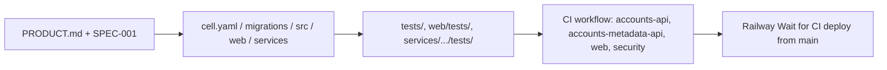

# 04 — Traceability (RTM)

Requirement มาจาก `PRODUCT.md` (Capabilities and Constraints) และ `specs/001-l2-baseline/spec.md` (AC-01..AC-09) Release = workflow `CI` (`.github/workflows/ci.yml`) แล้ว Railway Wait for CI deploy จาก `main`

| ID | Requirement | Code module | Test | Release / workflow |
|---|---|---|---|---|
| AC-01 | Z3 และ trust zone ที่ไม่รู้จักถูกปฏิเสธ (422) | `cell.yaml` `identity.trust_zone`, `migrations/0001_accounts.sql` CHECK | `tests/test_identities.py::test_strictly_isolated_and_unknown_zones_are_refused` | CI job `accounts-api` |
| AC-02 | slug ไม่ซ้ำต่อ workspace | `cell.yaml` `unique: true`, `UNIQUE (workspace_id, slug)` | `tests/test_identities.py::test_a_slug_is_used_once_per_workspace` | `accounts-api` |
| AC-03 | ไม่เก็บ plaintext address | `migrations/0002_ciphertext_only.sql` | `tests/test_mailboxes.py::test_a_plaintext_address_in_the_ciphertext_is_refused`, `::test_a_plaintext_address_in_the_hash_is_refused` | `accounts-api` |
| AC-04 | address hash ไม่ซ้ำต่อ workspace | `cell.yaml` `unique: [[address_hash]]` | `tests/test_mailboxes.py::test_the_same_address_hash_is_stored_once_per_workspace` | `accounts-api` |
| AC-05 | handle ไม่ซ้ำต่อ platform | `UNIQUE (workspace_id, platform, handle)` | `tests/test_platform_accounts.py::test_a_handle_is_used_once_per_platform` | `accounts-api` |
| AC-06 | risk report อ่านเฉพาะ workspace ผู้เรียก | `src/solo_accounts/routes.py` `ctx.bound`, RLS | `tests/test_risk_report_route.py::test_the_report_reads_only_the_callers_workspace` | `accounts-api` |
| AC-07 | risk report ต้อง read ทั้ง 4 resource | `routes.py` `ctx.allow` loop | `tests/test_risk_report_route.py::test_read_permission_on_every_resource_is_required` | `accounts-api` |
| AC-08 | report ไม่คืน ciphertext/hash | `routes.py` `COLUMNS` | `tests/test_risk_report_route.py::test_the_report_never_returns_ciphertext_or_hashes` | `accounts-api` |
| AC-09 | account `planned` ไม่ถูก report | `routes.py` `LIVE_ACCOUNT` | `tests/test_risk_report_route.py::test_a_planned_account_is_not_reported_until_it_is_in_use` | `accounts-api` |
| P-01 | Risk rules 13 codes | `routes.py` `analyse()` | `tests/test_risk_report.py` (12 tests) | `accounts-api` |
| P-02 | CRUD, authz, isolation, idempotency, version conflict, import legacy id | `src/cellkit/app.py` | `tests/test_contract.py` → `src/cellkit/contract.py` (17 tests × resources) | `accounts-api` |
| P-03 | `security_keys` 0..20, ints fit column | `cell.yaml`, `app.py` `_constraints` | `tests/test_mailboxes.py::test_security_keys_are_counted_from_0_to_20`, `contract.py::test_numbers_fit_their_columns` | `accounts-api` |
| P-04 | references must exist (422 `reference_not_found`) | `app.py` `write()` FK handling | `tests/test_mailboxes.py::test_a_recovery_mailbox_must_exist`, `tests/test_platform_accounts.py::test_an_unknown_login_mailbox_is_refused`, `contract.py::test_missing_reference` | `accounts-api` |
| P-05 | new accounts start `planned` + MFA `unknown` | `cell.yaml` defaults | `tests/test_platform_accounts.py::test_a_new_account_is_planned_with_unknown_mfa` | `accounts-api` |
| P-06 | Sentry ไม่ส่ง PII | `src/cellkit/_sentry.py` | `tests/test_sentry.py` | `accounts-api` |
| P-07 | Web: address encryption bound to tenant + hash | `web/lib/crypto.ts`, `web/lib/form.ts` | `web/tests/crypto.test.ts` | CI job `web` |
| P-08 | Web: one allow-listed subject, sealed session | `web/lib/auth.ts` | `web/tests/auth.test.ts` | `web` |
| P-09 | Web: password + TOTP (RFC 6238) | `web/lib/password.ts` | `web/tests/password.test.ts` | `web` |
| P-10 | Web: 15-minute lockout after failures | `web/lib/auth-routes.ts` | **gap** — no test | `web` |
| P-11 | Web: nonce CSP per request | `web/proxy.ts` | **gap** — no test | `web` |
| P-12 | metadata-api read-only, anonymous identities as counts only | `services/accounts-metadata-api/server.py` | `services/accounts-metadata-api/tests/test_server.py` | CI job `accounts-metadata-api` |
| P-13 | risk report limits: 20,000 rows (413), 1,000 findings | `routes.py` `MAX_ROWS`, `MAX_FINDINGS` | **gap** — no test found for 413 / `truncated` | `accounts-api` |

Sources: `PRODUCT.md`, `specs/001-l2-baseline/spec.md`, `cell.yaml`, `migrations/*.sql`, `src/solo_accounts/routes.py`, `src/cellkit/app.py`, `src/cellkit/contract.py`, `tests/*.py`, `web/tests/*.ts`, `services/accounts-metadata-api/tests/test_server.py`, `.github/workflows/ci.yml`, `.railway/railway.ts`

## Open questions
- SPEC-001 status "in review (owner approval pending)"; commit `e7de6ce` บันทึก "changes requested" — ใครปิด
- Requirement ID ใน `PRODUCT.md` ไม่มีเลข จึงตั้ง P-xx ในเอกสารนี้เท่านั้น
