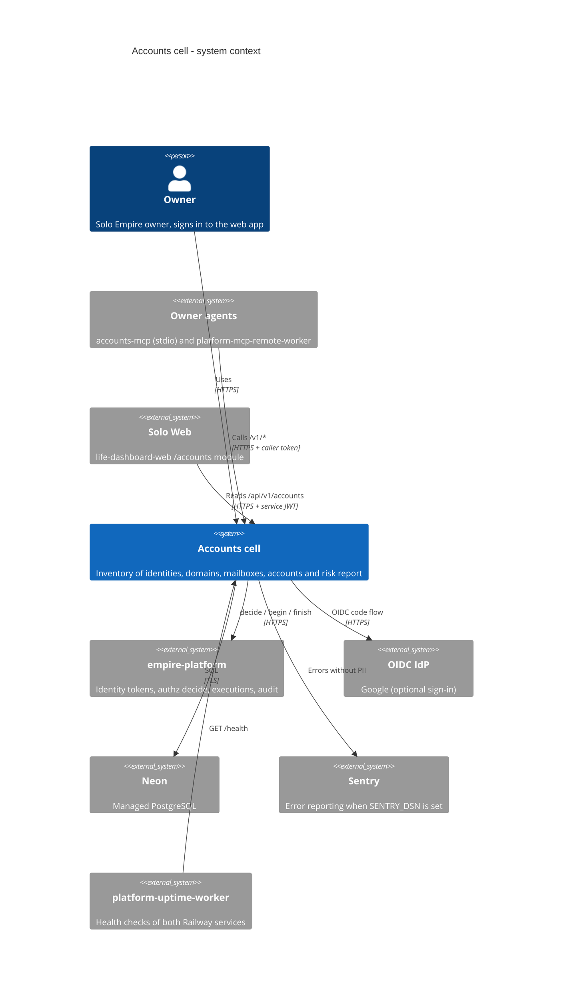

# 05 — C4 Context

| Element | Evidence |
|---|---|
| Owner, web | `README.md` §Web, `web/lib/auth.ts` |
| Agents | `.mcp.json`, `AGENTS.md`, `PRODUCT.md` Users (remote hub lists `accounts-api-production-cfee.up.railway.app`) |
| Solo Web | `PRODUCT.md` Users, `services/accounts-metadata-api/server.py` |
| empire-platform | `src/cellkit/platform.py` (`/v1/authz/decide`, `/v1/executions`) |
| Neon | `README.md`, `src/cellkit/db.py` (`NEON_API`) |
| Sentry | `src/cellkit/_sentry.py`, `services/accounts-metadata-api/_sentry.py` |
| Uptime | `PRODUCT.md` Operating Context; `platform-uptime-worker` `src/targets.ts` lines 44–45 (read-only check of sibling repo) |

Sources: `README.md`, `PRODUCT.md`, `AGENTS.md`, `.mcp.json`, `src/cellkit/platform.py`, `src/cellkit/db.py`, `src/cellkit/_sentry.py`, `web/lib/auth.ts`, `services/accounts-metadata-api/server.py`

## Open questions
- Solo Web ยังเป็น consumer จริงหรือไม่ (`PRODUCT.md` [ต้องยืนยัน])
- Cell นี้ยังไม่อยู่หลัง edge gateway `gateway.bookchaowalit.com` ตามที่ repo เห็น (ไม่มี config ใน repo) — ต้องยืนยันกับ registry
