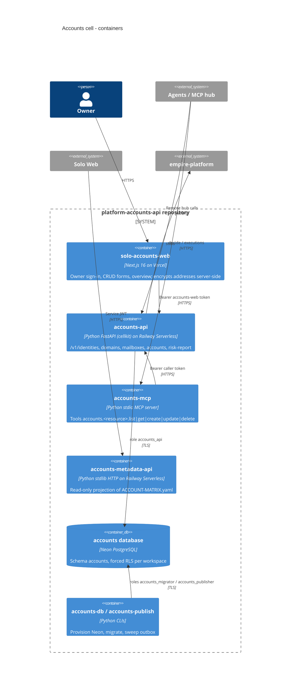

# 06 — C4 Container

| Container | Runtime | Evidence |
|---|---|---|
| accounts-api | `Dockerfile` (python:3.13-slim, `CMD accounts-api`), port 3623 (`cell.yaml`) | `.railway/railway.ts`, `src/cellkit/server.py` |
| accounts-metadata-api | `services/accounts-metadata-api/Dockerfile` (python:3.12-slim, port 3470) | `services/accounts-metadata-api/service.yaml`, `railway.toml` |
| solo-accounts-web | `web/package.json` (next 16.4.2), `web/vercel.json` | `README.md` §Web |
| accounts-mcp | `pyproject.toml` `[project.scripts]` | `.mcp.json`, `src/cellkit/mcp.py` |
| DB roles | `db/roles.sql` | `migrations/0001_accounts.sql` grants |

Sources: `.railway/railway.ts`, `Dockerfile`, `services/accounts-metadata-api/Dockerfile`, `services/accounts-metadata-api/service.yaml`, `web/package.json`, `web/vercel.json`, `pyproject.toml`, `.mcp.json`, `db/roles.sql`, `cell.yaml`

## Open questions
- `accounts-publish` ไม่มี Railway service/cron ใน `.railway/railway.ts` — ไม่ได้รัน (ไม่มี graph event อยู่แล้ว)
