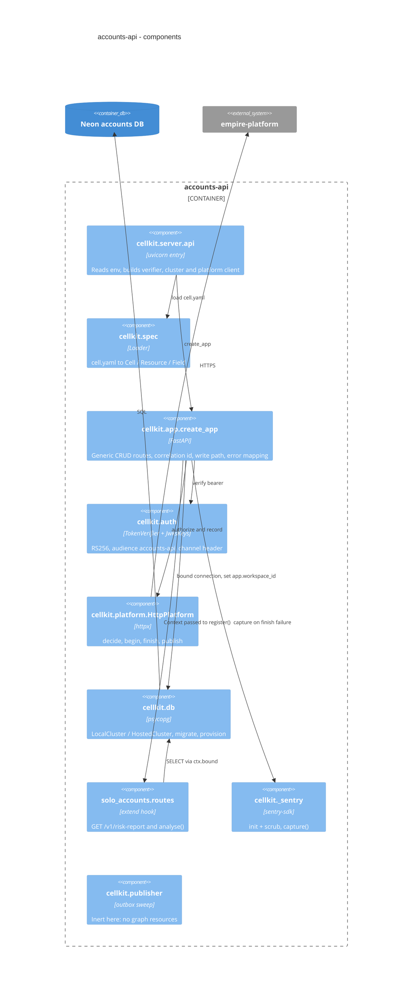

# 07 — C4 Component (accounts-api)

Sources: `src/cellkit/server.py`, `src/cellkit/spec.py`, `src/cellkit/app.py`, `src/cellkit/auth.py`, `src/cellkit/platform.py`, `src/cellkit/db.py`, `src/cellkit/_sentry.py`, `src/cellkit/publisher.py`, `src/solo_accounts/routes.py`, `src/cellkit/__init__.py`, `docs/cellkit-notes.md`

หมายเหตุ: `cellkit` เป็น code ของ repo นี้เอง (ADR-0001) ส่วน `cellkit.mcp`, `cellkit.importer`, `cellkit.contract`, `cellkit.testing` ไม่ได้อยู่ใน runtime path ของ API

## Open questions
- ไม่มี
