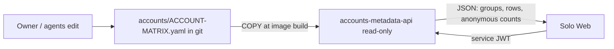

# ADR-0007 — `ACCOUNT-MATRIX.yaml` ใน git เป็น canonical source ของ metadata และ serve ผ่าน service read-only แยก

- Status: accepted (retro-documented)
- Date: retro-documented 2026-11-04 จาก `origin/main` `0b1378a`; evidence 2026-10-11 (`b28bb84`, `a480f34`) และ 2026-10-12 (`c226a9e`)

## Context

ก่อนมี accounts cell บน Neon ข้อมูล account matrix อยู่ใน `accounts/ACCOUNT-MATRIX.yaml` ที่คนและ AI agent แก้ใน git; Solo Web ต้องการ JSON ของ matrix นี้ (groups, account rows, สรุป anonymous identities) โดยไม่ผูกกับ CRUD API ที่ต้องมี workspace token และ PDP

## Decision

- `accounts/ACCOUNT-MATRIX.yaml` ยังเป็น canonical source; `services/accounts-metadata-api/server.py` เป็นแค่ projection read-only (docstring: "this service only reshapes it into JSON", `service.yaml` `writes: []`, `secrets: []`)
- service แยก process และ image: Python stdlib `ThreadingHTTPServer`, `python:3.12-slim`, port 3470; matrix ถูก `COPY` เข้า image ตอน build (`services/accounts-metadata-api/Dockerfile`)
- auth ด้วย service JWT ผ่าน `service_auth` ที่ vendored ไว้ใน `vendor/service-auth` (ไม่ใช่ cellkit/PDP ของ accounts-api)
- ไม่อ่าน credentials; anonymous identities คืนเป็น aggregate count เท่านั้น เพื่อไม่ให้ UI เชื่อมกับ public identity ได้
- deploy เป็น Railway service ที่สอง `accounts-metadata-api` (Serverless, healthcheck `/ready`) ใน project เดียวกัน

## Evidence

- `services/accounts-metadata-api/server.py` (docstring, anonymous aggregate ใน `project_matrix` ~บรรทัด 118–190)
- `services/accounts-metadata-api/Dockerfile` (`COPY accounts/ACCOUNT-MATRIX.yaml`), `service.yaml`, `railway.toml`
- `services/accounts-metadata-api/vendor/service-auth/`
- `.railway/railway.ts` (`service("accounts-metadata-api", …)`)
- commits `b28bb84`, `a480f34`, `c226a9e`

## Consequences

- matrix ใหม่ถึง production ต่อเมื่อ build image ใหม่ (push `main` → CI → Railway); ไม่มี reload ระหว่างรัน
- มีสอง model ของข้อมูล account คู่กัน: matrix ใน git (metadata-api) และ table `accounts.*` ใน Neon (accounts-api) — ไม่มี sync ระหว่างกันใน repo
- service มี auth/Sentry/test ของตัวเอง (coverage gate 78 %) แยกจาก accounts-api

## Open questions

- Solo Web ยังเรียก service นี้อยู่หรือไม่ และเมื่อไรจะเลิกใช้ matrix แทน accounts-api (README/PRODUCT.md [ต้องยืนยัน])
- `service.yaml` `deploy.target: unassigned` ล้าสมัย

Sources: `services/accounts-metadata-api/{server.py,Dockerfile,service.yaml,railway.toml}`, `.railway/railway.ts`, `git log` (`b28bb84`, `a480f34`, `c226a9e`)
