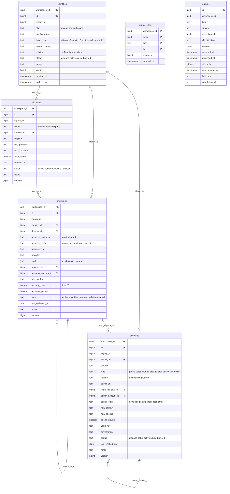

# 09 — ERD

Schema `accounts` บน Neon database `accounts` ทุก PK เป็น `(workspace_id, id)` และทุก FK รวม `workspace_id` (อ้างข้าม workspace ไม่ได้) ทุกตารางมี forced RLS `workspace_isolation`

- `create_keys`: idempotent create (key จอง record id ก่อนเริ่ม platform execution)
- `outbox`: มีในทุก cell แต่ไม่มี resource ไหนประกาศ `graph` จึงว่าง (`docs/cellkit-notes.md`)
- `domains`, `accounts` ก็มี `created_at`/`updated_at` เหมือน `identities` (ละไว้ใน diagram)
- ข้อมูลอีกชุด: `accounts/ACCOUNT-MATRIX.yaml` (ไฟล์ใน Git, อ่านโดย `accounts-metadata-api`) ไม่ใช่ database

Sources: `migrations/0001_accounts.sql`, `migrations/0002_ciphertext_only.sql`, `cell.yaml`, `db/roles.sql`, `docs/cellkit-notes.md`, `services/accounts-metadata-api/service.yaml`

## Open questions
- ไม่มี
