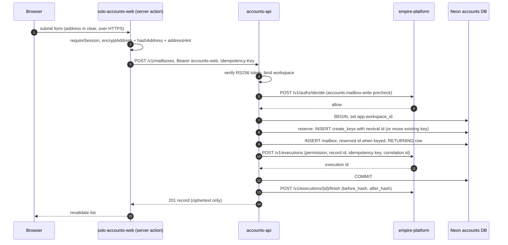
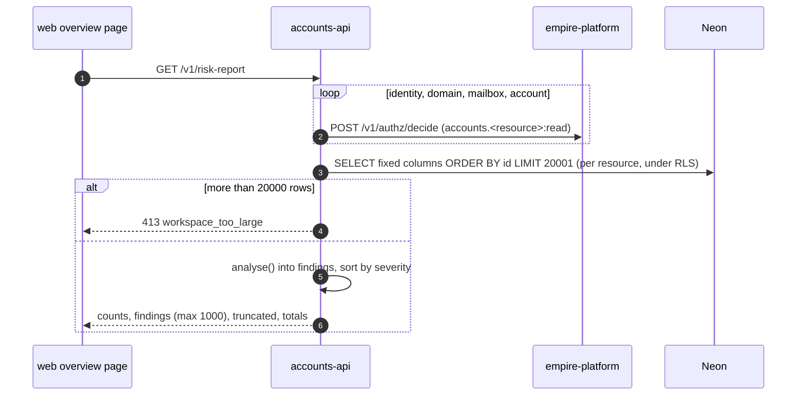
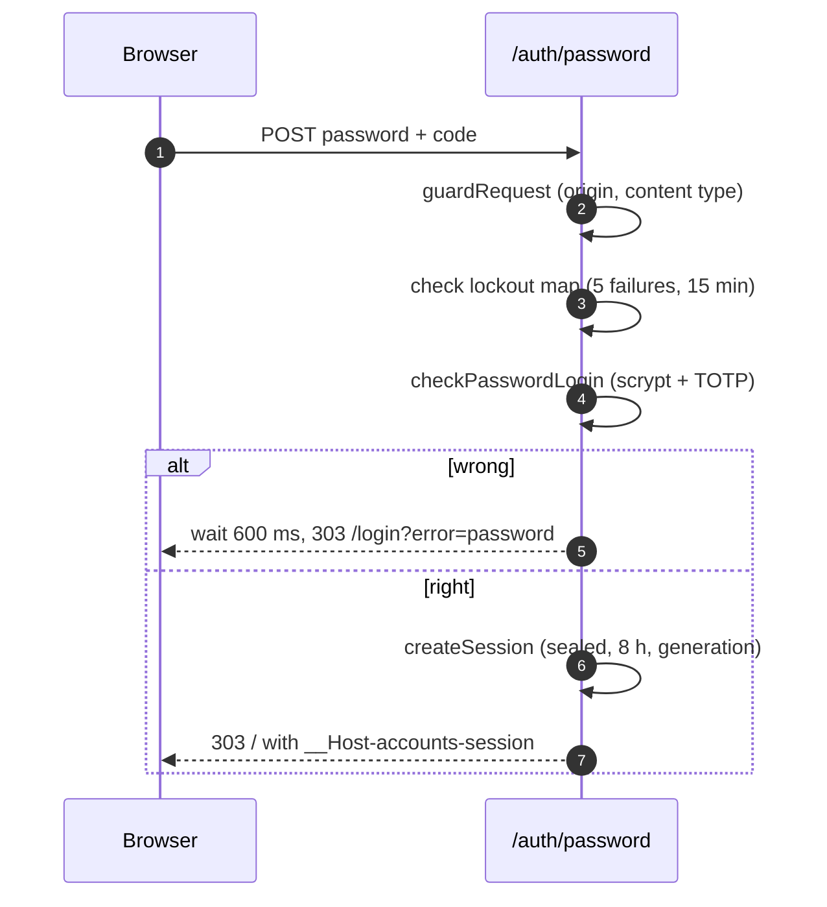
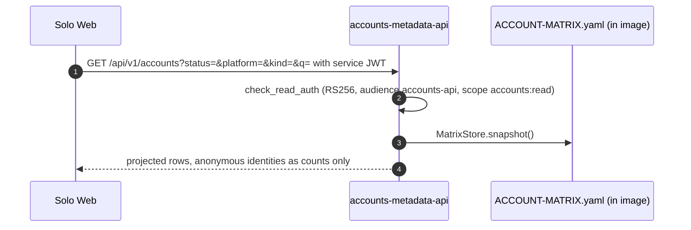

# 10 — Sequences

## 1. Create mailbox จาก web (write path พร้อม execution)

## 2. Risk report

## 3. Password sign-in

## 4. Solo Web reads the account matrix

Sources: `web/app/actions.ts`, `web/lib/form.ts`, `web/lib/crypto.ts`, `web/lib/api.ts`, `web/lib/auth-routes.ts`, `web/lib/password.ts`, `web/app/page.tsx`, `src/cellkit/app.py`, `src/cellkit/platform.py`, `src/solo_accounts/routes.py`, `services/accounts-metadata-api/server.py`, `services/accounts-metadata-api/Dockerfile`

## Open questions
- ไม่มี (ลำดับ reserve → INSERT อ่านจาก `src/cellkit/app.py` `reserve()` และ create handler)
