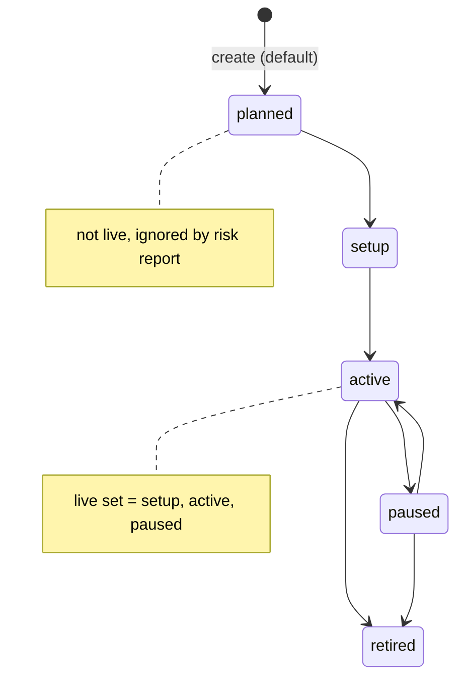
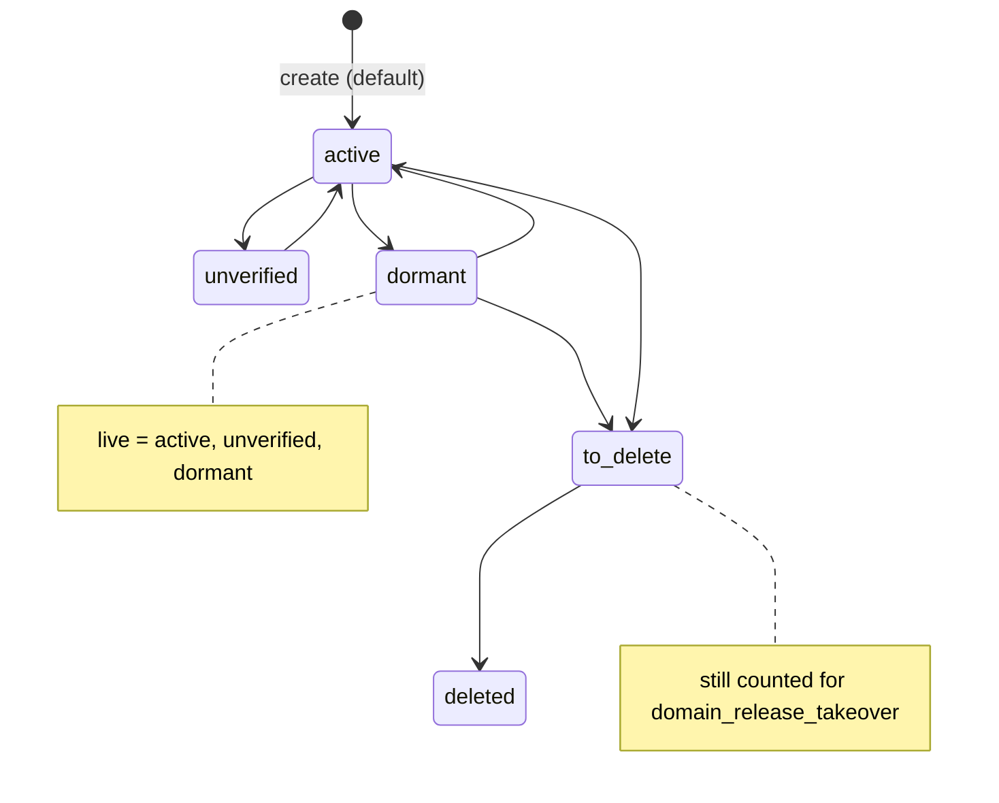
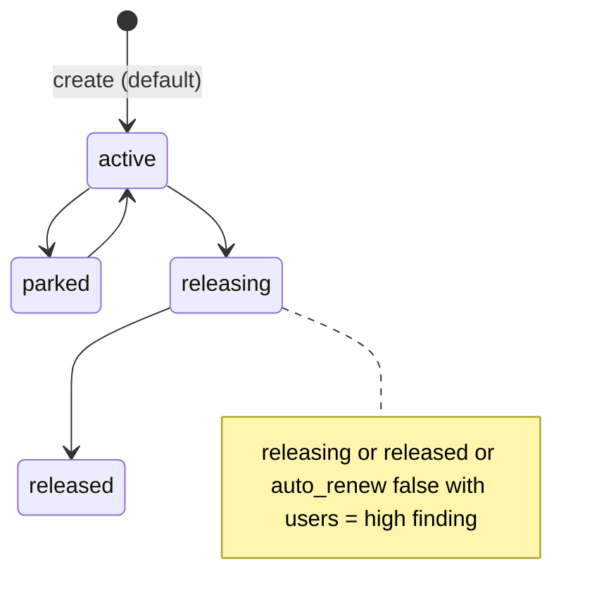
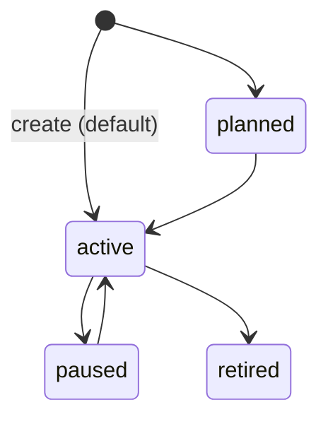

# 11 — State machines

ทุก `status` เป็น enum ใน `cell.yaml` + CHECK constraint API **ไม่บังคับ transition** (PATCH ตั้งค่าใดก็ได้ใน enum) diagram ด้านล่างจึงแสดง **ค่าที่มีและความหมายที่ code ใช้** (เช่น risk report ถือว่า "live" สถานะไหน) ลูกศรแสดงลำดับที่ตั้งใจตามชื่อ ไม่ใช่กติกาที่ code บังคับ

## Account

## Mailbox

## Domain

## Identity

(`to_delete` ใน diagram = ค่า `to-delete` จริง)

Sources: `cell.yaml`, `migrations/0001_accounts.sql`, `src/solo_accounts/routes.py` (`LIVE_MAILBOX`, `LIVE_ACCOUNT`, domain rules), `src/cellkit/app.py` (PATCH ไม่มี transition check)

## Open questions
- ควรบังคับ transition (เช่น ห้าม `deleted` → `active`) หรือไม่
