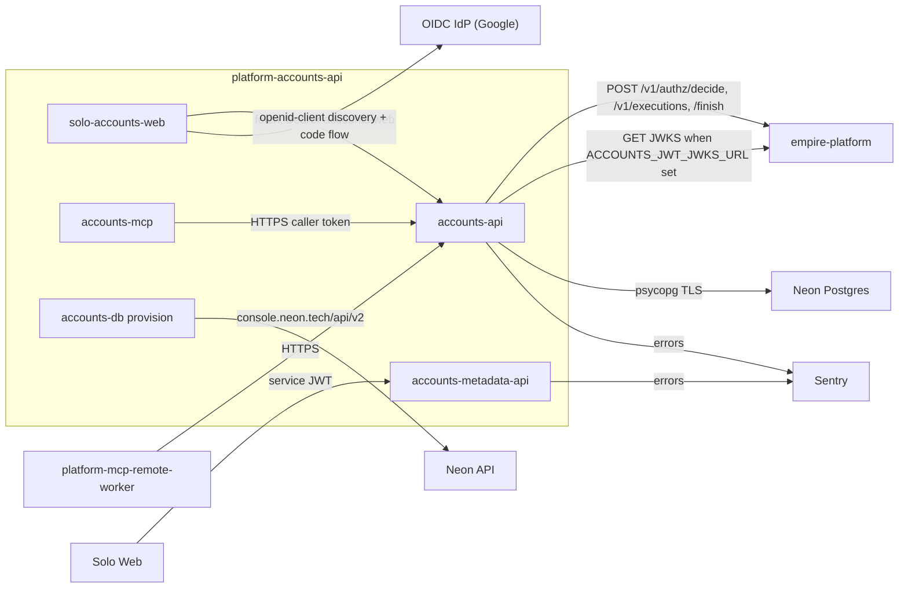

# 12 — API and integrations

## accounts-api (`https://accounts-api-production-cfee.up.railway.app`)

| Method | Path | Notes |
|---|---|---|
| GET | `/health` | `{"status":"ok"}`, Railway healthcheck |
| GET | `/v1/{plural}` | filters ตาม `cell.yaml` + `id`, `legacy_id`, `updated_since`, `null`, `order`, `after_id`, `limit` (≤ 1000), `offset` |
| GET | `/v1/{plural}/stats` | `group_by` หนึ่ง filter field |
| GET | `/v1/{plural}/legacy/{legacy_id}` | record จากระบบเก่า |
| GET | `/v1/{plural}/{id}` | หนึ่ง record |
| POST | `/v1/{plural}` | `Idempotency-Key`; `legacy_id` เก็บ id เดิม → 201 |
| PATCH | `/v1/{plural}/{id}` | `expected_version` |
| DELETE | `/v1/{plural}/{id}` | 409 `has_dependents` ถ้ายังถูกอ้าง |
| GET | `/v1/risk-report` | read ทั้ง 4 resource; 413 > 20,000 rows |

`plural` = `identities`, `domains`, `mailboxes`, `accounts` Headers: `Authorization: Bearer`, `X-Empire-Channel` (`api|mcp|workflow|cli|event`), `X-Correlation-Id` (echo กลับ) Error map: 401 unauthenticated, 403 deny, 404, 409 conflict/replayed, 422 invalid_value/reference_not_found, 503 unavailable/authorization_unavailable

## accounts-metadata-api (`https://accounts-metadata-api-production.up.railway.app`)

| Method | Path | Notes |
|---|---|---|
| GET | `/health` | liveness |
| GET | `/ready` | Railway healthcheck, fail-closed readiness |
| GET | `/api/v1/accounts` | `status`, `platform`, `kind`, `q`; read-only |

## External integrations

Sources: `src/cellkit/app.py`, `src/cellkit/auth.py`, `src/cellkit/platform.py`, `src/cellkit/server.py`, `src/cellkit/db.py`, `src/cellkit/mcp.py`, `src/solo_accounts/routes.py`, `services/accounts-metadata-api/server.py`, `web/lib/api.ts`, `web/lib/auth.ts`, `PRODUCT.md`, `README.md`

## Open questions
- ไม่มี OpenAPI file commit ไว้ (FastAPI สร้าง `/openapi.json` ที่ runtime); `services/accounts-metadata-api/contracts/accounts.v1.md` เป็น contract ของ metadata-api เท่านั้น
