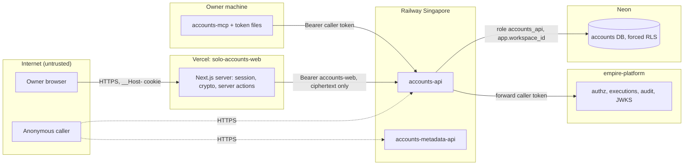

# 13 — Threat model (DFD + STRIDE)

| Element | S | T | R | I | D | E | Existing mitigations | Gaps |
|---|---|---|---|---|---|---|---|---|
| Web sign-in | password guess | — | — | — | burst | — | scrypt + TOTP, 5 failures → 15 min lock, 600 ms delay, one allow-listed subject, OIDC PKCE + nonce (`auth-routes.ts`, `auth.ts`) | lockout per warm instance only; no test for lockout |
| Web session | cookie theft | — | — | — | — | — | `__Host-`, httpOnly, secure, sameSite lax, sealed JWE, 8 h, generation revoke | — |
| Web pages | — | XSS | — | address leak | — | — | nonce CSP, `connect-src 'self'`, `frame-ancestors 'none'` (`proxy.ts`), `guardRequest` origin check | CSP untested |
| accounts-web token | — | — | — | leak | — | over-scope | server-only, 30 days, `accounts.*` only (`api.ts`, README) | manual renewal (`renew-web-token.sh`) |
| accounts-api | forged JWT | body tampering | — | — | large scan | cross-workspace | RS256 verify, audience, hosted refuses dev issuer; Pydantic `extra=forbid`; risk report 413 cap; RLS | no rate limit found in code |
| Authz | — | — | denial of action | — | platform down = 503 | bypass | platform decide per read; execution bound to record + permission | finish failure only logged |
| Audit | — | — | yes | — | — | — | execution with before/after row hash at empire-platform | audit store outside this repo |
| Neon DB | — | — | — | plaintext emails | — | BYPASSRLS | ciphertext only + `@` CHECK, `accounts_api` NOBYPASSRLS NOINHERIT, FORCE RLS | backup coverage unknown (14) |
| metadata-api | static token | — | — | anonymous identities | — | — | RS256 service JWT scope `accounts:read`; static token never production auth (test); counts only for anonymous | — |
| Sentry | — | — | — | PII in events | — | — | `send_default_pii=False`, scrub, no URL/body/locals, tracing off (`_sentry.py`) | — |
| Secrets in repo | — | — | — | — | — | — | Railway/Vercel variables only; CI `security` job (shared workflow) | branch `main` not protected (GitHub API 404) |

Sources: `web/lib/auth.ts`, `web/lib/auth-routes.ts`, `web/lib/request-guard.ts`, `web/proxy.ts`, `web/lib/api.ts`, `web/lib/crypto.ts`, `src/cellkit/auth.py`, `src/cellkit/app.py`, `src/cellkit/server.py`, `src/cellkit/_sentry.py`, `src/solo_accounts/routes.py`, `migrations/*.sql`, `db/roles.sql`, `services/accounts-metadata-api/server.py`, `services/accounts-metadata-api/tests/test_server.py`, `.github/workflows/ci.yml`, `scripts/renew-web-token.sh`, `gh api repos/bookchaowalit/platform-accounts-api/branches/main/protection` (404, 2026-11-04)

## Open questions
- ควรเปิด branch protection บน `main` หรือไม่ (ตอนนี้ไม่มี; Wait for CI ป้องกัน deploy แต่ไม่ป้องกัน push)
- rate limiting ที่ Railway/edge มีหรือไม่
