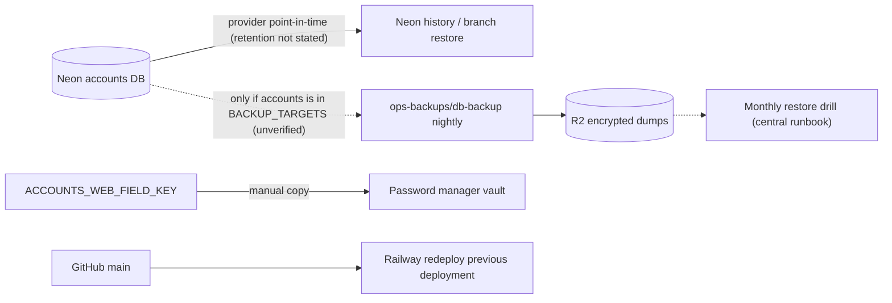

# 14 — Backup / DR

## ข้อมูลที่มี

| Data | Where | Backup / restore reality |
|---|---|---|
| Inventory (identities, domains, mailboxes, accounts, create_keys, outbox) | Neon project `platform-accounts-api`, DB `accounts`, `aws-ap-southeast-1` | Neon provider history/branching (ฟีเจอร์ provider; retention ไม่ระบุใน repo). Central nightly backup `platform-db-backup` (Railway `ops-backups/db-backup`, R2, age-encrypted) ใช้ `BACKUP_TARGETS` + `BACKUP_URL_<NAME>` ที่ตั้งใน Railway — **repo นี้และ repo backup ไม่ได้ระบุว่า `accounts` อยู่ใน target list** |
| Field key `ACCOUNTS_WEB_FIELD_KEY` | Vercel variable | README: "keep a copy in the vault" — เสีย key = address ทั้งหมดอ่านไม่ได้ |
| Session / password / TOTP secret, `accounts-web` token | Vercel variables; token file `~/.config/empire-platform/tokens` | renew ได้ด้วย `scripts/renew-web-token.sh`; password ตั้งใหม่ด้วย `web/scripts/set-password.ts` |
| DB URLs per role | Railway variables, `~/.config/solo-accounts/` (owner-only) | re-provision ด้วย `accounts-db provision` |
| ACCOUNT-MATRIX.yaml + `accounts/` | Git (this repo) | Git history |
| Audit / executions | empire-platform | นอก repo นี้ |
| Code / images | GitHub + Railway deployments | rollback = redeploy deployment เดิมใน Railway |

- **RTO / RPO: not defined** (ไม่มีใน `README.md`, `PRODUCT.md`, `specs/`)
- ops record: prod-baseline-monitoring-backups (2026-11-03) — ระบุ "The 30 Neon DBs are backed up by Railway `ops-backups/db-backup` (cron 19:00 UTC)" แต่ไม่ได้ระบุชื่อ DB นี้

Sources: `README.md`, `AGENTS.md`, `src/cellkit/db.py`, `src/cellkit/server.py`, `web/lib/crypto.ts`, `scripts/renew-web-token.sh`, `web/scripts/set-password.ts`, `platform-db-backup` `scripts/backup.sh` + `README.md` (read-only), ops record: prod-baseline-monitoring-backups (2026-11-03)

## Open questions
- `accounts` อยู่ใน `BACKUP_TARGETS` ของ `ops-backups/db-backup` หรือไม่ (owner ตรวจชื่อ target ใน Railway)
- Neon history retention ของ project นี้เท่าไร
- RTO/RPO เป้าหมาย
- สำเนา `ACCOUNTS_WEB_FIELD_KEY` อยู่ใน vault จริงหรือไม่
