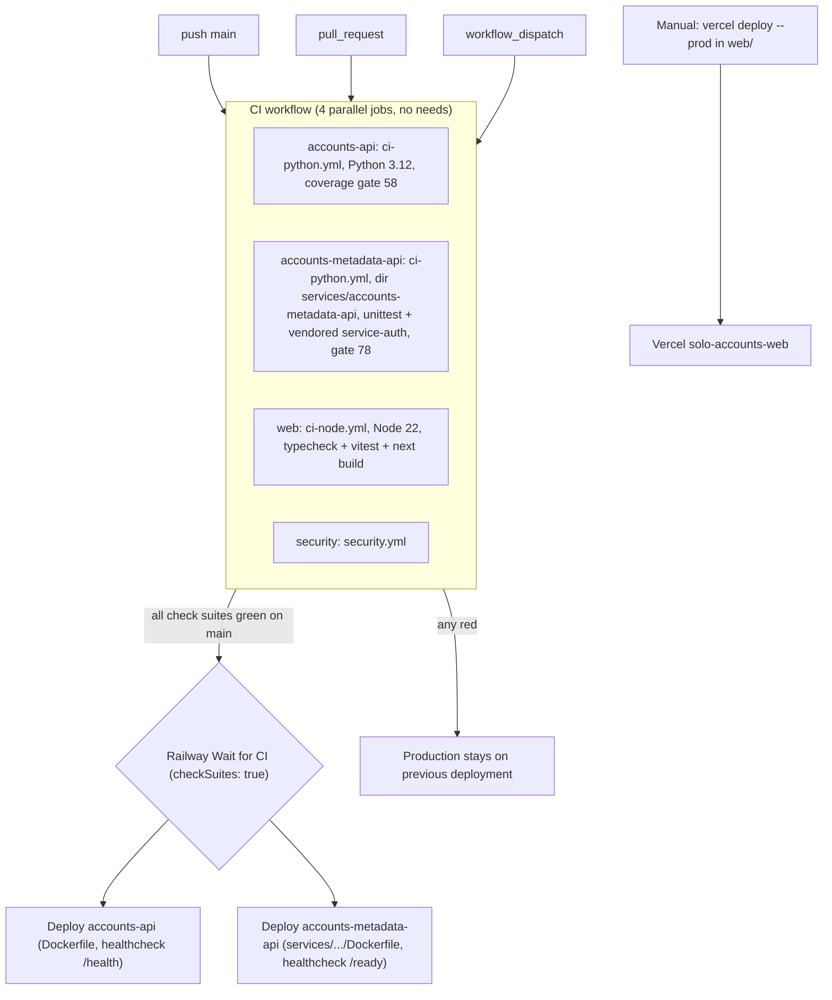

# 15 — CI/CD pipeline

Workflow เดียว `.github/workflows/ci.yml` (`CI`) triggers: push `main`, `pull_request`, `workflow_dispatch`; `concurrency: ci-<ref>` cancel-in-progress; `permissions: contents: read` ทุก job เป็น reusable workflow จาก `bookchaowalit/platform-ci-workflows` pinned SHA `87dc5e1` (v1.1.1) — repo public จึงใช้ GitHub-hosted runners (comment บรรทัดแรก)

Sources: `.github/workflows/ci.yml`, `.railway/railway.ts`, `README.md` (Deploys, Web), `AGENTS.md`

## Open questions
- รายละเอียด step ภายใน reusable workflow (ruff, mypy, scanners) อยู่ใน `platform-ci-workflows@87dc5e1` ไม่ได้อ่านใน pack นี้
- Vercel project `solo-accounts-web` ผูก Git (push = deploy) หรือ manual เท่านั้น — README บอก manual
- lint ของ web ถูก skip ("No Biome/ESLint config yet")
