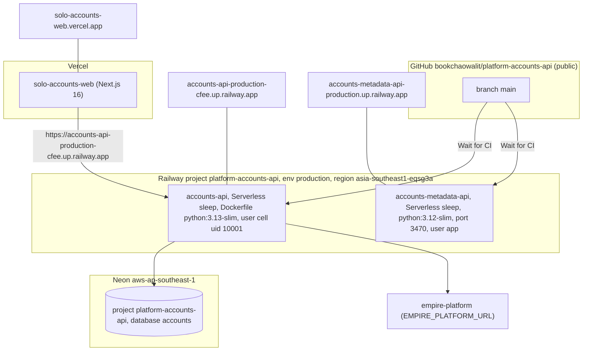

# 16 — Deployment

| Item | Value | Evidence |
|---|---|---|
| Railway services | `accounts-api` (id `216592e8…`), `accounts-metadata-api` (id `5f4568e6…`), environment `production` | `.railway/railway.ts`; Railway API list-services (read 2026-11-04) |
| Region | `asia-southeast1-eqsg3a` (first deploy 2026-10-10 was `us-east4-eqdc4a`) | README `railway scale`; Railway deployment list |
| Env (names only) | `SENTRY_DSN`, `ACCOUNTS_DB_MODE=hosted`, `ACCOUNTS_DB_URL_API`, `ACCOUNTS_JWT_PUBLIC_KEY_PEM`, `ACCOUNTS_JWT_ISSUER`, `EMPIRE_PLATFORM_URL`; metadata: `ACCOUNTS_API_*` | `README.md`, `.railway/railway.ts`, `services/accounts-metadata-api/server.py` |
| Web env | ดู `web/.env.example` (ไม่ได้อ่านใน pack นี้), `ACCOUNTS_API_URL`, `ACCOUNTS_API_TOKEN`, `ACCOUNTS_WEB_FIELD_KEY`, `ACCOUNTS_WEB_OWNER_SUBJECTS`, `ACCOUNTS_WEB_SESSION_GENERATION` | `web/lib/api.ts`, `web/lib/crypto.ts`, `web/lib/auth.ts`, README |
| Custom domains | none found in repo | — |

Sources: `.railway/railway.ts`, `Dockerfile`, `services/accounts-metadata-api/Dockerfile`, `services/accounts-metadata-api/railway.toml`, `README.md`, `PRODUCT.md`, `web/vercel.json`, `web/package.json`, `web/lib/*.ts`, Railway API (project `platform-accounts-api`, 2026-11-04)

## Open questions
- `services/accounts-metadata-api/service.yaml` บอก `deploy.target: unassigned` ขัดกับ Railway ที่ deploy อยู่ — ควรอัปเดต
- `accounts-metadata-api` ไม่อยู่ใน `online-systems.yaml` (`PRODUCT.md` [ต้องยืนยัน])
