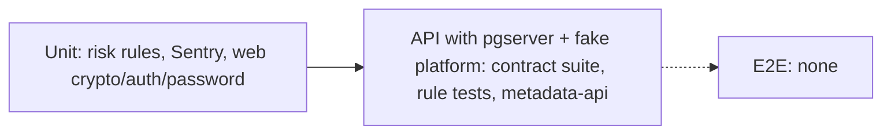

# 17 — Test coverage matrix

Test levels ที่มีจริง: **unit** (pure functions), **API/integration** (FastAPI TestClient + embedded PostgreSQL `pgserver` + fake platform, `tests/conftest.py`, `src/cellkit/testing.py`), **web unit** (Vitest) ไม่มี e2e/browser test และไม่มี test ที่เรียก hosted service (`AGENTS.md`) Coverage gates: accounts-api 58 % (measured 60.98 % 2026-10-22), accounts-metadata-api 78 % (80.62 %)

| Feature | Unit | API / integration | E2E | Test files |
|---|---|---|---|---|
| CRUD, filters, version conflict, import legacy id | — | yes (per resource) | gap | `tests/test_contract.py` → `src/cellkit/contract.py` |
| Authorization + workspace isolation | — | yes | gap | `contract.py::test_authorization`, `::test_workspace_isolation`, `tests/test_identities.py::test_another_workspace_cannot_read_an_identity` |
| Idempotent create / execution bound to record | — | yes | gap | `contract.py::test_idempotent_create`, `::test_executions_are_bound_to_the_record` |
| JWT / JWKS verification | — | yes | — | `contract.py::test_jwks_verification`, `::test_jwks_falls_back_to_the_pinned_key` |
| Identity rules (zones, slug) | — | yes (8) | gap | `tests/test_identities.py` |
| Mailbox rules (ciphertext only, hash unique, security keys) | — | yes (8) | gap | `tests/test_mailboxes.py` |
| Account rules (handle per platform, defaults, refs) | — | yes (6) | gap | `tests/test_platform_accounts.py` |
| Risk rules `analyse()` | yes (12) | — | — | `tests/test_risk_report.py` |
| Risk report route (isolation, permission, no ciphertext) | — | yes (6) | gap | `tests/test_risk_report_route.py` |
| Risk report 413 / `truncated: true` | gap | gap | gap | — |
| Outbox publisher | — | yes (inert here) | — | `contract.py::test_publisher_delivers_the_outbox` |
| Sentry scrub (api) | yes (8) | — | — | `tests/test_sentry.py` |
| Metadata API auth, readiness, projection | — | yes (12) | gap | `services/accounts-metadata-api/tests/test_server.py` |
| Sentry scrub (metadata) | yes (8) | — | — | `services/accounts-metadata-api/tests/test_sentry.py` |
| Vendored service-auth | yes | — | — | `services/accounts-metadata-api/vendor/service-auth/tests/test_auth.py` (unmeasured) |
| Web address crypto + form body | yes (8) | — | gap | `web/tests/crypto.test.ts` |
| Web session / subjects | yes (5) | — | gap | `web/tests/auth.test.ts` |
| Web password + TOTP | yes (4) | — | gap | `web/tests/password.test.ts` |
| Web lockout, CSP proxy, request guard, pages | gap | gap | gap | — |
| MCP server tools | gap | gap | — | — (`src/cellkit/mcp.py` ไม่มี test ใน `tests/`) |
| DB provision / migrate CLI | gap | migrations applied in test DB | — | `src/cellkit/testing.py` |

Sources: `tests/*.py`, `src/cellkit/contract.py`, `src/cellkit/testing.py`, `web/tests/*.ts`, `web/vitest.config.ts`, `services/accounts-metadata-api/tests/*.py`, `.github/workflows/ci.yml`, `AGENTS.md`, `specs/001-l2-baseline/spec.md`

## Open questions
- `tests/test_contract.py` ใช้ `from cellkit.contract import *`; ไม่ได้ตรวจว่า `contract.py` ใช้ `src/cellkit/testing.py` สำหรับ harness ทุก test หรือไม่ (นับ test จาก `def test_` เท่านั้น)
