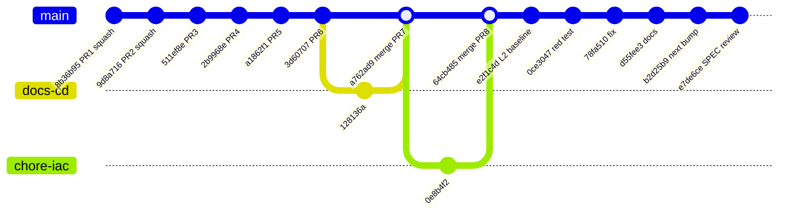
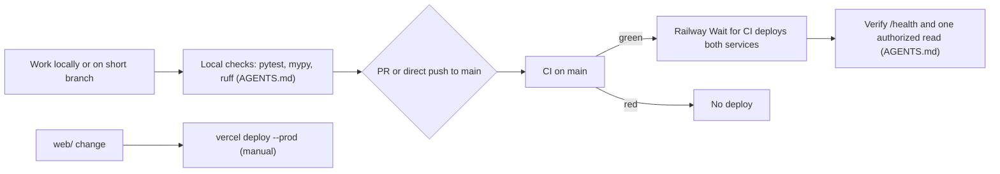

# 18 — Git / release workflow

ข้อเท็จจริงจาก history: PR #1–#8 merged ระหว่าง 2026-10-17 ถึง 2026-10-18 (ส่วนใหญ่ merge ภายใน 1–6 นาที, #1 29 นาที); หลังจากนั้นเป็น direct push ลง `main` (main-only ตาม SPEC-001 "committed straight to `main`") และ merge commit ของ PR #7/#8 (`a762ad9`, `64cb485`) `main` ไม่มี branch protection

Sources: `git log origin/main`, `gh pr list --state merged` (2026-11-04), `gh api .../branches/main/protection` (404), `AGENTS.md`, `README.md`, `specs/001-l2-baseline/spec.md`, `.railway/railway.ts`

## Open questions
- ไม่มี tag/release — version ใช้ commit SHA เท่านั้น
- PR #1–#6 เป็น squash merge (commit เดียวบน `main`); #7 และ #8 เป็น merge commit
