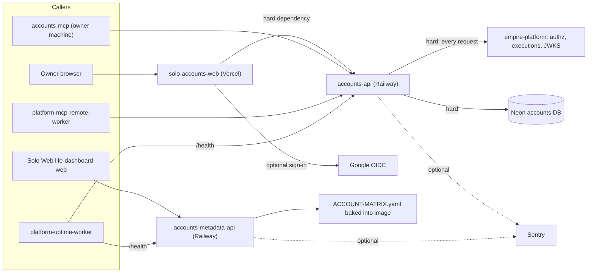

# 19 — Service dependency map

| Dependency | Failure effect | Evidence |
|---|---|---|
| empire-platform down | reads and writes 503 `authorization_unavailable`; JWKS cache keeps last good keys | `src/cellkit/app.py`, `src/cellkit/auth.py` |
| Neon down | 503 `unavailable` | `src/cellkit/app.py` `bound()` |
| accounts-api asleep | first web request waits (timeout 20 s) | `web/lib/api.ts`, `.railway/railway.ts` |
| Sentry unset | error reporting off | `src/cellkit/_sentry.py` |

Sources: `src/cellkit/app.py`, `src/cellkit/auth.py`, `src/cellkit/platform.py`, `src/cellkit/_sentry.py`, `web/lib/api.ts`, `web/lib/auth.ts`, `services/accounts-metadata-api/Dockerfile`, `.railway/railway.ts`, `PRODUCT.md`, `platform-uptime-worker` `src/targets.ts` (read-only), `platform-mcp-remote-worker` `src/worker.ts` line 129 (read-only)

## Open questions
- empire-platform base URL (`EMPIRE_PLATFORM_URL`) ชี้ไป service ไหนหลังการแยก platform-identity (11-03) — ไม่อยู่ใน repo
