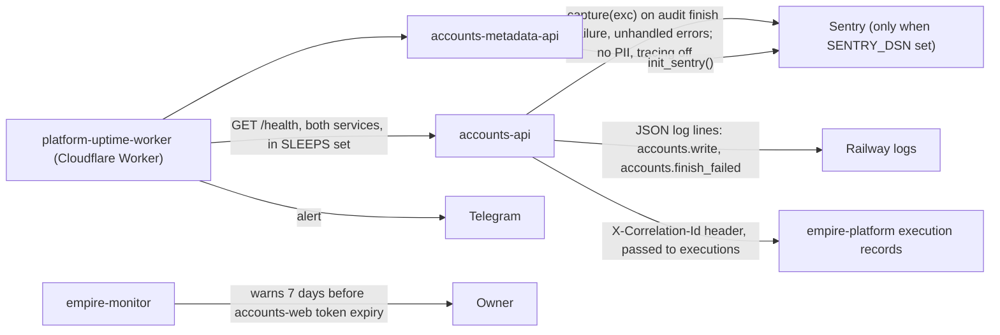

# 20 — Observability

| Signal | What is watched | Evidence |
|---|---|---|
| Sentry errors | exceptions; scrub removes URL, body, headers, locals; `send_default_pii=False` | `src/cellkit/_sentry.py`, `services/accounts-metadata-api/_sentry.py`, tests |
| Structured logs | write events with action, execution, actor, workspace (no token) | `src/cellkit/app.py` |
| Correlation id | per request, echoed in response | `src/cellkit/app.py` `correlate` |
| Uptime | `/health` of `accounts-api-production-cfee` and `accounts-metadata-api-production` | `platform-uptime-worker/src/targets.ts` lines 30, 44–45; ops record: prod-baseline-monitoring-backups (2026-11-03) alerts via Telegram |
| Token expiry | `accounts-web` token | `README.md` §Web |
| Product measures | high findings, review overdue, weak MFA, 5xx, p95 | `PRODUCT.md` — **no dashboard yet** |

Sources: `src/cellkit/_sentry.py`, `src/cellkit/__init__.py`, `src/cellkit/app.py`, `services/accounts-metadata-api/_sentry.py`, `services/accounts-metadata-api/server.py`, `README.md`, `PRODUCT.md`, `platform-uptime-worker` `src/targets.ts` (read-only), ops record: prod-baseline-monitoring-backups (2026-11-03)

## Open questions
- `SENTRY_DSN` ตั้งใน Railway ของทั้งสอง service แล้วหรือไม่ และ Sentry project ชื่ออะไร
- web (Vercel) ไม่มี Sentry/analytics ใน `web/package.json`
- ไม่มี heartbeat (ไม่มี cron ใน repo)
