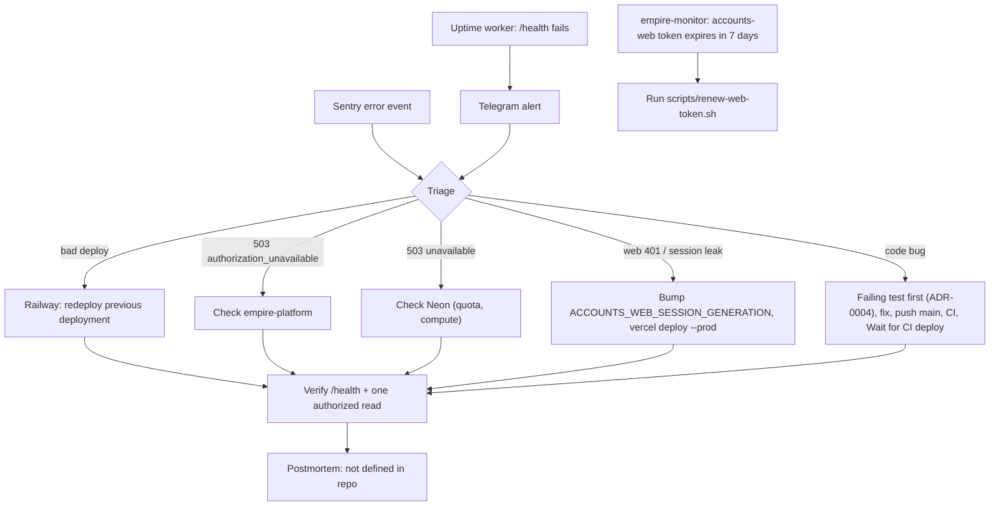

# 21 — Incident response

ช่องทาง alert ที่พบจริง: uptime worker → Telegram (`book_noti_bot`, ops record), Sentry (ถ้าตั้ง DSN), `empire-monitor` เตือน token หมดอายุ Runbook ที่ repo ระบุ: rollback = redeploy deployment ก่อนหน้าใน Railway; หลัง deploy ตรวจ `/health` และ authorized read หนึ่งครั้ง; sign out ทุก browser = bump `ACCOUNTS_WEB_SESSION_GENERATION` + redeploy; token = `scripts/renew-web-token.sh`

Sources: `README.md`, `AGENTS.md`, `docs/cellkit-notes.md`, `scripts/renew-web-token.sh`, `src/cellkit/app.py` (503 codes), ops record: prod-baseline-monitoring-backups (2026-11-03), ops record: neon-platform-quota (2026-11-03, general Neon quota behaviour)

## Open questions
- ไม่มี postmortem template หรือ incident log ใน repo
- ถ้า `ACCOUNTS_WEB_FIELD_KEY` รั่ว: ขั้นตอน rotate (kid `k2`) ยังไม่มีเอกสาร — `crypto.ts` บอกว่า "rotation adds keys without a format change" แต่ code มีแค่ `k1`
