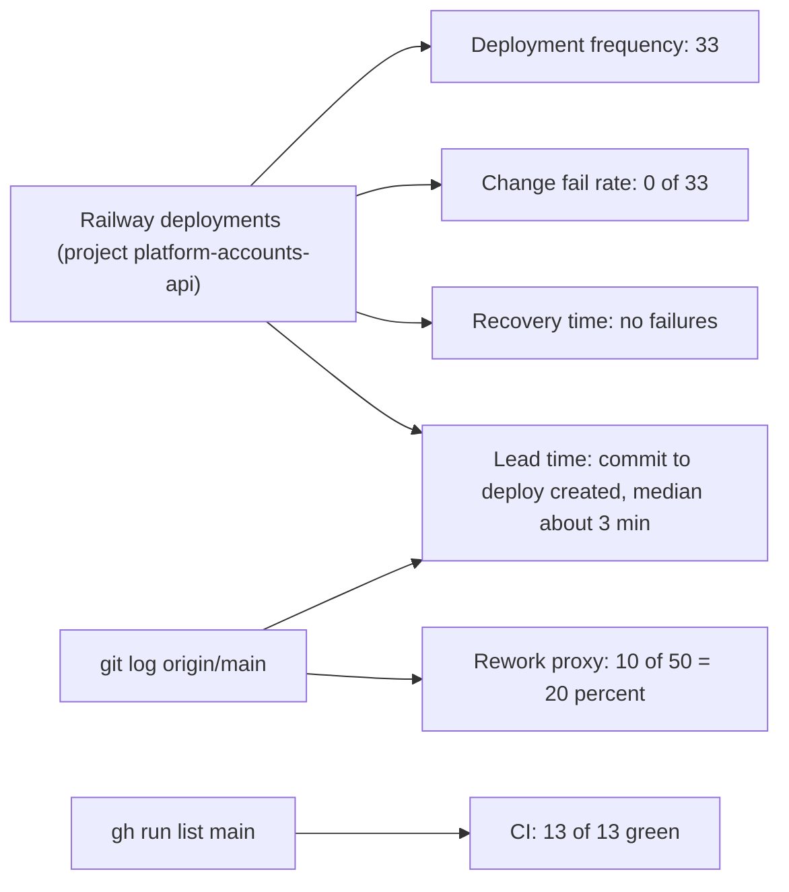

# 22 — DORA metrics

หน้าต่าง: 90 วันถึง 2026-11-04 (`--since="90 days ago"`) แหล่งข้อมูล deploy จริง = Railway deployment list ของ project `platform-accounts-api` (อ่านผ่าน Railway API 2026-11-04, 50 รายการล่าสุดครอบทั้งหน้าต่าง) + `git log` + `gh run list` CD เริ่ม 2026-10-18 (ก่อนหน้านั้น deploy ด้วย `railway up`/redeploy จาก CLI)

| Metric | How to measure for this repo | Current value (90 d) | Command | Confidence |
|---|---|---|---|---|
| Deployment frequency | Railway deployments (`reason` deploy/redeploy) ต่อ service | **33 deployments**: `accounts-api` 18, `accounts-metadata-api` 15, บน 8 วัน (10-10, 10-11, 10-12, 10-13, 10-18, 10-23, 10-24, 10-30) — ตั้งแต่ CD 2026-10-18: 11 rounds ต่อ service (10 จาก push ลง `main` + 1 redeploy 10-30) ≈ 0.6 deploy/วัน ในช่วง 10-18..11-04 | Railway API `deployments(projectId: 162c7657-…)`; `railway deployment list` | high (Railway source) |
| Lead time for changes | commit time (committer date) → Railway deployment created for that `commitHash` | median **≈ 3 min** over 5 commits with commit meta: `64cb485` 10 s, `a762ad9` 10 s, `e7de6ce` 3 m 19 s, `b2d25b9` 3 m 57 s, `3d60707` 63 m (deploy re-created at 09:39) | `git show -s --format=%cI <sha>` vs deployment `createdAt` | medium: build/rollout end time not available (deployment `updatedAt` changes on removal) |
| Change fail rate | deployments ending `FAILED` or `CRASHED` / all | **0 / 33 = 0 %** | Railway `list-deployments` status; `gh run list --branch main` = 13/13 CI success | medium: a deploy that is healthy but wrong would not show as failed |
| Failed deployment recovery time | first failed deploy → next successful | **not computable: no failed deployment in window** | — | n/a |
| Deployment rework rate | share of non-merge commits on `main` whose subject starts `fix` / `revert` | **10 / 50 = 20 %** (incl. 4 `fix(sentry)` follow-ups on one day and 1 revert `ae62e2a`) | `git log origin/main --since="90 days ago" --no-merges --format=%s \| grep -ciE '^(fix\|revert)'` ; `... \| wc -l` | low: proxy, not deploy-level rework |



Commands used (2026-11-04):

```bash
git log origin/main --since="90 days ago" --no-merges --format=%s | wc -l                      # 50
git log origin/main --since="90 days ago" --no-merges --format=%s | grep -ciE '^(fix|revert)'   # 10
gh run list --repo bookchaowalit/platform-accounts-api --branch main --limit 200 \
  --json conclusion,createdAt,workflowName                                                       # CI 13 success, 0 failure
# Railway API (MCP list-deployments, projectId 162c7657-83a8-443d-926a-aa4b14cb1f2d, limit 50)
```

หมายเหตุ: deployment 2026-10-30 18:47 UTC ของทั้งสอง service เป็น `redeploy` ไม่มี creator (ไม่ใช่ Git push) — นับรวมใน frequency Sentry `release` = `RAILWAY_GIT_COMMIT_SHA` (`src/cellkit/_sentry.py`) ใช้ผูก error กับ deploy ได้ในอนาคต Web (Vercel) ไม่ได้นับ

Sources: Railway API (project `platform-accounts-api`, services `accounts-api` / `accounts-metadata-api`, read 2026-11-04), `git log origin/main`, `gh run list`, `gh pr list`, `.railway/railway.ts`, `src/cellkit/_sentry.py`

## Open questions
- สาเหตุของ redeploy 2026-10-30 (ไม่มี creator)
- Vercel deploy ของ `solo-accounts-web` ควรนับรวมหรือแยก
